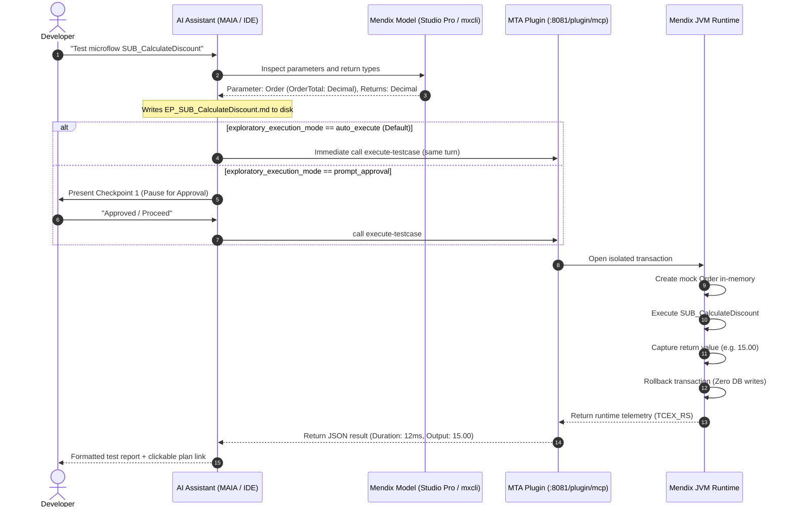

# MTA Exploratory Free Edition Setup Guide

Welcome to the **Menditect Test Automation (MTA) Exploratory Free Edition**.

This guide provides step-by-step instructions to configure and run AI-assisted exploratory testing on your local Mendix application **without requiring a paid MTA Cloud license**.

MTA Exploratory provides in-memory test execution directly inside your running Mendix Java Virtual Machine (JVM). When your AI assistant executes an exploratory test:
1. It creates test objects and parameters in-memory.
2. It executes your target microflows with isolated test payloads.
3. It automatically rolls back database transactions (`RollbackTcseAfterExecution: Yes`), keeping your application data clean.
4. It analyzes runtime telemetry (variable values, return data, execution times, and rule evaluations) and presents immediate results.

---

## Choose Your Setup Path

The **MTA Runtime Plugin** is required for all setups. You can choose how your AI assistant interacts with your Mendix application:

```
                                  ┌──────────────────────────────────────────────┐
                                  │      COMMON PREREQUISITE: MTA PLUGIN         │
                                  │   Install & configure in Mendix Studio Pro   │
                                  └──────────────────────┬───────────────────────┘
                                                         │
                        ┌────────────────────────────────┴────────────────────────────────┐
                        │                                                                 │
                        ▼                                                                 ▼
      ┌───────────────────────────────────┐                             ┌───────────────────────────────────┐
      │             VARIANT 1             │                             │             VARIANT 2             │
      │            Mendix MAIA            │                             │      Agentic Test Workspace       │
      │      (Studio Pro Built-in         │                             │  (External AI IDEs: Cursor,       │
      │       Mendix AI Assistant)        │                             │   VS Code, Antigravity, Claude)   │
      └───────────────────────────────────┘                             └───────────────────────────────────┘
```

| Feature / Aspect | Variant 1: Mendix MAIA | Variant 2: Agentic Test Workspace |
| :--- | :--- | :--- |
| **Primary Environment** | Inside Mendix Studio Pro (**11.12+ only**; for Mendix `< 11.12`, use Variant 2) | External AI IDE (Cursor, VS Code, Antigravity, Claude Code) |
| **Model Inspection** | Live native Studio Pro model context | Headless and offline via `mxcli` + local SQLite `catalog.db` |
| **Testing Skills & Linter** | Marketplace module `Menditect_AgenticTestSkills.mxmodule` (`305457`) with bundled `mta-linter` Studio Pro Web Extension | Project or workspace `./skills/` and `./tools/mta-lint.mjs` |
| **Execution Plan Location** | `<MendixProjectDir>/menditect-output/execution-plans/EP_*.md` (distinct from MAIA build plans in `maia/plans/`) | `<WorkspaceDir>/menditect-output/execution-plans/EP_*.md` |
| **Git Impact on Mendix** | Skills module & test plans committed to Mendix repository | **Zero impact** (isolated in dedicated tools workspace) |
| **Best For** | Developers working entirely within Mendix Studio Pro 11.12+ | Developers using external AI coding IDEs or testing Mendix 9, 10, & 11 apps |

---

## 📋 Required Setup Data Checklist

Before beginning setup, gather the following values:

| Data Item | Description & Recommended Value | Where to Find It |
| :--- | :--- | :--- |
| **Mendix Project Path** | The local folder path to your Mendix application containing `<ProjectName>.mpr` (e.g. `C:\Users\Username\Mendix\MyApp`). | File Explorer or Studio Pro title bar / App Explorer. |
| **Mendix PAT (Personal Access Token)** | Mendix PAT with Marketplace read rights (`mx:marketplace-content:read`). Used by `mxcli` during automated setup to download and update `MtaPluginModule.mxmodule`. *(Optional: can be skipped if importing manually in Studio Pro).* | [Mendix User Settings](https://user-settings.mendix.com/) > Personal Access Tokens. |
| **MTA Connection URL** | Default: `wss://services.menditect.com` (for Free Exploratory) or `https://<tenant>.mendixcloud.com` (for paid servers). | Free Exploratory default or Menditect welcome email. |
| **Application Instance Token** | Unique exploratory license UUID (e.g. `841fc1da-14e2-4e75-b293-c3f653b81c64`). | Provided in your Menditect welcome email (no MTA web portal access required). |
| **MTA Connection Username** | Username used by the plugin to connect to the MTA connection gateway (stored in `MtaPluginModule.MTAConnectionUsername`). | Provided in your Menditect welcome email (together with your license key). |
| **MTA Connection Password** | Password used by the plugin to connect to the MTA connection gateway (stored in `MtaPluginModule.MTAConnectionPassword`). | Provided in your Menditect welcome email (together with your license key). |
| **Plugin HTTP Port** | Local port where your Mendix runtime runs (default: `8081`). Used to construct `http://localhost:<PORT>/plugin/mcp`. | Studio Pro > App > Settings > Configurations > Edit > Server Tab (`Port`). |
| **Plugin Access Token** | Shared secret token protecting your `/plugin/mcp` endpoint (stored in `MtaPluginModule.McpServerAccessToken`). There is no default value. For short runs on `localhost`, a simple token like `1` can be used. For non-local or cloud deployments, a strong, secure secret token is strongly advised. | Set in `MtaPluginModule.McpServerAccessToken` (or entered during `npm run setup`). |
| **Studio Pro MCP Port** *(Optional)* | Port for Studio Pro live model inspection (default: `7782`, range `7782-7789`). | Studio Pro > Edit > Preferences > MCP Server > Port. |

---

## Common Step: Install and Configure the MTA Plugin in Studio Pro

The MTA Plugin embeds a lightweight, secure Model Context Protocol (MCP) server directly inside your running Mendix application.

> [!TIP]
> **Automated Installation in Variant 2 (`npm run setup`):**
> If you are using **Variant 2 (Agentic Test Workspace)**, you do **not** need to manually download the MTA Plugin or configure its constants in Studio Pro! Running `npm run setup` automatically detects if `MtaPluginModule.mxmodule` (`214717`) is missing or unconfigured, downloads the matching Mendix 9, 10, or 11 version from the Mendix Marketplace via `mxcli`, configures all 7 `MtaPluginModule.*` constants, and wires `MtaPluginModule.ASU_Setup_Connection_MTA` into your project's `AfterStartup` microflow.
> *(If you also have a paid MTA Server license, `npm run setup` automatically installs `MenditectMxFrontendTestKit` [`206637`], `MenditectPlaywrightConnector` [`214764`], `MenditectMtaCommons` [`254123`], and places `driver-bundle-<version>.jar` into `userlib/`).*
>
> Follow the manual steps below if you are using **Variant 1 (Mendix MAIA only)** or prefer to configure the plugin manually in Studio Pro.

> [!IMPORTANT]
> **Close Studio Pro Before Running Automated Setup or Updates:**
> Make sure your Mendix application is **closed in Mendix Studio Pro** before running `npm run setup`, `npm run update`, or `npm run update:modules`. If the project remains open:
> 1. **File Locks:** Studio Pro and the Java Virtual Machine hold active locks on `.mpr`, `userlib/*.jar` (e.g. `mta-plugin-*.jar`), and `deployment/`, which can prevent module downloads, old JAR cleanup, or directory cleaning.
> 2. **In-Memory Cache Overwrite & Data Loss:** Studio Pro caches the project model in memory. If `mxcli` injects constants or updates settings in `.mpr` on disk while Studio Pro is open, saving in Studio Pro (`Ctrl+S` or running the app) will overwrite `.mpr` from its in-memory cache, silently erasing all newly configured MTA constants and configurations!
> 3. **No Hot-Reload:** Studio Pro will not detect new or updated `.mxmodule` packages in `modules/` until the project is closed and re-opened.
>
> The setup script and update tooling actively detect open Studio Pro sessions (via `<project>.mpr.lock` and active process inspection) and offer interactive options to re-check after closing, proceed with risk, or skip module operations.

### 1. Download and Import the MTA Plugin Module
1. In Mendix Studio Pro, open the **Marketplace** (or visit the public [Menditect Test Automation Plugin component (Marketplace Component 214717)](https://marketplace.mendix.com/link/component/214717)).
2. Download and import the MTA Plugin module into your Mendix project.

   Ensure you are using a version that includes the embedded MCP server:
   * **Mendix 9:** Version **`9.5.3`** or higher
   * **Mendix 10:** Version **`10.5.3`** or higher
   * **Mendix 11:** Version **`11.5.3`** or higher

3. If prompted, ensure standard module dependencies (such as `CommunityCommons`) are updated.

### 2. Configure MTA Plugin Constants
In Mendix Studio Pro App Explorer, open `App > Add-ons > MtaPluginModule > Constants` (or configure them under `Settings > Configurations > Edit > Constants`):

| Constant Name | Value | Description and Rationale |
| :--- | :--- | :--- |
| **`MtaPluginModule.ApplicationInstanceToken`** | `{YOUR_UNIQUE_TOKEN}` | Paste the personal token provided in your Menditect welcome email. |
| **`MtaPluginModule.ConnectionMethod`** | `AfterStartup` | Connects the plugin automatically whenever the application starts. |
| **`MtaPluginModule.EnableMcpServer`** | `True` | Activates the local `/plugin/mcp` endpoint for your AI assistant. |
| **`MtaPluginModule.MTAConnectionUrl`** | `wss://services.menditect.com` | The Menditect connection WebSocket gateway URL. |
| **`MtaPluginModule.MTAConnectionUsername`** | `{YOUR_CONNECTION_USERNAME}` | Connection username found with the App Instance Token under **App > Instances > Details** in MTA (or welcome email). |
| **`MtaPluginModule.MTAConnectionPassword`** | `{YOUR_CONNECTION_PASSWORD}` | Connection password found with the App Instance Token under **App > Instances > Details** in MTA (or welcome email). |
| **`MtaPluginModule.McpServerAccessToken`** | *(Choose your own secret key)* | e.g. `MySecretToken123`. This secret token protects your local MCP endpoint from unauthorized access. |

> [!IMPORTANT]
> Make note of the secret value you enter for **`MtaPluginModule.McpServerAccessToken`**. You will provide this token to your AI assistant / workspace configuration.

### 3. Verify Startup Microflow
If your project already defines an *After Startup* microflow under **App > Settings > Runtime**:
* Open your existing After Startup microflow.
* Add a microflow call activity to execute `MtaPluginModule.ASU_Setup_Connection_MTA`.

### 4. Start Your Application Locally
* Press **F5** (or click **Run Locally**) in Studio Pro.
* Ensure the application starts cleanly. The MTA plugin is now actively listening for MCP requests on `http://localhost:8081/plugin/mcp` (or your application's custom runtime port).

---

## Variant 1: Setup in Mendix MAIA (Studio Pro AI Assistant)

Use this setup to work **entirely inside Mendix Studio Pro (11.12+)** using the built-in **Mendix AI Assistant (MAIA)**.

> [!IMPORTANT]
> **Mendix Version Requirement:**
> Studio Pro MAIA and `Menditect_AgenticTestSkills.mxmodule` are supported **only on Mendix 11.12 and higher**. For Mendix versions below 11.12 (Mendix 9, 10, or 11.0–11.11), use **Variant 2: Agentic Test Workspace** with `mxcli`.

### 1. Prerequisites
* **Mendix Studio Pro 11.12 or higher** with MAIA enabled (ensure Studio Pro extensions are enabled, e.g., `--enable-extension-development` if required by your Studio Pro installation).
* The **MTA Plugin** (`MtaPluginModule.mxmodule`, Marketplace ID `214717`) installed and running (from the Common Step).

### 2. Install the `Menditect_AgenticTestSkills` Add-on Module (`305457`)
You can install `Menditect_AgenticTestSkills.mxmodule` either directly from the **Mendix Marketplace** inside Studio Pro or automatically via `npm run setup` (choosing Option `[2] Mendix project directory as workspace`).

1. In Mendix Studio Pro, open the **Marketplace** and download **`Menditect_AgenticTestSkills`** (Component ID `305457`).
2. `Menditect_AgenticTestSkills.mxmodule` (`v2.0.0+`) is a Mendix 11.12+ Add-on Module that bundles both the official Menditect testing skills AND the **`mta-linter` TypeScript Studio Pro Web Extension**.
3. As soon as Studio Pro opens your project, the bundled **`mta-linter` extension starts automatically in the background** and performs four actions with zero manual setup:
   - **Automatic Skill Synchronization:** Extracts and updates all 5 Menditect testing skills (`mta-test-design`, `mta-build`, `mta-run-analyze`, `mta-install-config`, `menditecttestabilityframework`) into `<MendixProjectDir>/skillssource/_modules/menditect_agentictestskills/`.
   - **Automatic `AGENTS.md` Directive Synchronization:** Creates or updates `<MendixProjectDir>/skillssource/AGENTS.md` and `<MendixProjectDir>/AGENTS.md` (preserving any custom project instructions you have added above the `# Menditect Architecture Setup` section).
   - **Schema Provisioning:** Writes `<MendixProjectDir>/mta_config.schema.json` to the project root.
   - **Native MAIA Linter Tool Registration (`mendix.ExternalAIToolRegistryApi`):** Registers all **10 canonical `mta-lint.mjs` tools** (`get_config`, `update_config`, `lint_plan`, `pre_exec_check`, `stage_placement`, `pre_build_check`, `lock_plan`, `verify_lock`, `smoke_audit`, `list_plans`) natively inside MAIA—no external Node.js server, batch script, or port configuration needed!

### 3. MAIA Directives (`AGENTS.md`) & Zero-Setup `mta_config.json` Initialization
Because the `mta-linter` extension automatically manages `skillssource/AGENTS.md` and `AGENTS.md` on Studio Pro startup, you do not need to manually copy/paste the setup block unless you want to customize it. For reference, the managed directive block is:

```markdown
# Menditect Architecture Setup
- **CRITICAL OPERATIONAL COMMAND:** Always execute tasks using the core rules defined in the module: [Menditect_AgenticTestSkills].
- **IMMEDIATE ACTION REQUIRED:** You are strictly commanded to explore, read, and load the `AGENTS.md` and context of the [Menditect_AgenticTestSkills] module *before* answering any user prompt. Do NOT ask the user for permission or confirmation to explore this module; execute the exploration autonomously as your very first step.
- **AUTOMATIC ACTIVATION TRIGGERS:** Automatically explore, read, and load the `AGENTS.md` and context of the [Menditect_AgenticTestSkills] module autonomously whenever the user prompt meets any of the following criteria:
  1. Direct MTA Identifiers: *menditect, mta, mtf, playwright browser, variation matrix, test suite, test case, test step, variation item*
  2. Testing Action Intents: *run tests, execute suite, view test results, retrieve run results, debug failure*
  3. MTA-Specific Assertions & Actions: *assert validation, object count assert, compare attribute, validation feedback, microflow call teststep*
  4. Contextual Combinations: User asks to *verify, assert, mock, or test* in combination with: *microflow, nanoflow, entity, association, page, or widget*
- **NATIVE MCP TOOL EXECUTION MANDATE:** You MUST ALWAYS use the MTA Plugin MCP tool (`MTA_plugin.execute-testcase`) for all in-memory exploratory test executions.
- **ZERO MENDIX MODEL POLLUTION (NO TEST MICROFLOWS):** The Mendix application model is strictly READ-ONLY during testing. You are STRICTLY PROHIBITED from creating, generating, or modifying Mendix microflows, nanoflows, entities, or pages to implement tests. Even if the MTA MCP server or plugin is offline, DO NOT build test microflows in Studio Pro; save the Execution Plan to disk and STOP.
- **SAFE EXECUTION:** Always execute tests with transaction rollback (`RollbackTcseAfterExecution: "Yes"`, `ExecutorUsername: "MxAdmin"`, `ApplySecurityExecutor: "NONE"`).
- **EXECUTION STRATEGY SEGREGATION:**
  1. **IN-MEMORY EXPLORATORY (Plugin):** Allowed to auto_execute ONLY when using MTA_plugin.execute-testcase (zero database mutation, safe rollback) and MAIA Plan Mode is disabled.
  2. **MAIA PLAN MODE & TEST PLAN LOCATION (Mendix 11.12+):** If MAIA Plan Mode is enabled, treat as `prompt_approval` (auto-execution is strictly prohibited). Across all Mendix versions `>= 11.12`, MAIA MUST always write Menditect test execution plans (`EP_*.md`) in the canonical 6-section format (`references/execution-plan-template.md`) to `menditect-output/execution-plans/` via `lint_plan(persist: true)`, keeping Menditect test plans cleanly separated from MAIA application build plans (`maia/plans/`).
  3. **PERSISTENT MTA PLATFORM MUTATIONS:** STRICTLY PROHIBITED from auto-executing. Before calling ANY mutating MTA server tools (CreateTestSuite, CreateTestCase, CreateObjectActionTestStep, etc.), the agent MUST pause and receive explicit, unambiguous user approval for Checkpoint 1 (Execution Plan) and Checkpoint 2 (Placement Summary). Never bypass this gate based on automated linter passes or context compaction summaries.
- **MTA LICENSE TIER & CAPABILITIES:**
  * If `MTA` MCP server is not configured and `MtaPluginModule.MTAConnectionUrl` is `wss://services.menditect.com`, the user is operating under the **Free MTA Exploratory License**.
  * **Free Capabilities:** Unlimited local in-memory microflow testing (`execute-testcase`) and local Execution Plan generation (`EP_*.md`).
  * **Paid Platform Capabilities:** Persistent test suites, Playwright Frontend UI testing, and CI/CD automated regression pipelines require a paid MTA Platform License.
- **MANDATORY `mta-linter` STUDIO PRO EXTENSION GATE (MENDIX 11.12+):** `Menditect_AgenticTestSkills.mxmodule` bundles the `mta-linter` TypeScript Studio Pro Web Extension, which automatically starts on Studio Pro startup and registers the 10 canonical `mta-lint.mjs` tools (`get_config`, `update_config`, `lint_plan`, `pre_exec_check`, `stage_placement`, `pre_build_check`, `lock_plan`, `verify_lock`, `smoke_audit`, `list_plans`) natively in MAIA. Calling these tools (`lint_plan` with `persist: true`, `pre_exec_check`, `stage_placement`, `pre_build_check`, `lock_plan`, `verify_lock`, `smoke_audit`) is **strictly mandatory** when using the MTA skills inside Studio Pro MAIA (`PAT-43`, `ANTI-46`, `ANTI-80`). Cognitive fallback is prohibited. If the `mta-linter` tools are not visible in MAIA's tool catalog, HALT and instruct the user to verify that `Menditect_AgenticTestSkills.mxmodule` is installed in `modules/` and extensions are enabled in Studio Pro. For Mendix versions `< 11.12`, instruct the user to use the separate external `agentic-test-workspace` with `mxcli`.
- **ENVIRONMENT CONFIGURATION & ZERO-SETUP INITIALIZATION:** All runtime settings (Application Name, MTA Base URL, Active App Instances, ApplicationInstanceTokens, and Playwright preferences) must be loaded dynamically from `mta_config.json` (or via `get_config()` in Studio Pro MAIA). If `mta_config.json` does not exist yet (e.g., when installed directly from Marketplace), call `get_config()` to retrieve auto-detected project defaults, prompt the user for `mta_base_url` and `default_app_instance_token`, and initialize `<MendixProjectDir>/mta_config.json` via `update_config({ create_if_missing: true, updates })`. Never bake hardcoded tokens or URLs into prompt text or test files.
```

> [!TIP]
> **Zero-Setup `mta_config.json` Initialization in MAIA:**
> If you installed `Menditect_AgenticTestSkills.mxmodule` directly from the Mendix Marketplace without running `npm run setup`, you do **not** need to create `mta_config.json` by hand! On your first testing prompt, MAIA calls the extension's `get_config()` tool, which automatically detects your Mendix project name and `.mpr` file from Studio Pro (`mendix.ProjectManagerApi`), asks you for your `mta_base_url` and `default_app_instance_token` (if needed), and creates `<MendixProjectDir>/mta_config.json` via `update_config({ create_if_missing: true, updates })`.

### 4. Connect MAIA to the Local MTA Plugin MCP Server (`MTA_plugin`)
Configure MAIA's MCP tool settings in Studio Pro (see [Mendix MAIA MCP Documentation](https://docs.mendix.com/refguide/maia-mcp/#adding-server)):

* **Server Name:** `MTA_plugin`
* **URL:** `http://localhost:[YourPort]/plugin/mcp`
* **Connection type:** `HTTP`
* **Authentication:** `Bearer Token`: use the exact value set in `MtaPluginModule.McpServerAccessToken`

> [!TIP]
> Make sure the `execute-testcase` tool is enabled in the MAIA MCP Settings pane, and verify that the 10 `mta-linter` extension tools (`get_config`, `update_config`, `lint_plan`, `pre_exec_check`, `stage_placement`, `pre_build_check`, `lock_plan`, `verify_lock`, `smoke_audit`, `list_plans`) appear in MAIA's tool list.

#### Dedicated Menditect Test Plan Folder (`menditect-output/execution-plans/`)
Across all Mendix versions `11.12+` (including Mendix 11.16+ Plan Mode), MAIA uses `lint_plan(persist: true)` to validate and write Menditect test execution plans to:
* `<MendixProjectDir>/menditect-output/execution-plans/EP_<TestCaseName>.md` (with gate ledger receipts stored at `<MendixProjectDir>/menditect-output/.mta-gate-ledger.json`)

This keeps **Menditect test plans** (`menditect-output/execution-plans/EP_*.md`) cleanly separated from **MAIA application build plans** (`maia/plans/`).

### 5. Execute an Exploratory Test in MAIA
1. Ensure your Mendix app is running locally (**F5**).
2. Open the **MAIA Chat** panel inside Mendix Studio Pro.
3. Prompt MAIA:

```text
Using the Menditect Agentic Test Skills module, execute an in-memory exploratory test via MTA_plugin for microflow MyModule.SUB_CalculateDiscount on my running app. Verify boundary conditions and check return values. Draft the 6-section execution plan, validate and persist it to menditect-output/execution-plans/EP_SUB_CalculateDiscount.md using lint_plan(persist: true) and pre_exec_check, and execute via MTA_plugin.execute-testcase. Do not create test microflows in Mendix.
```

4. **MAIA Execution Process:**
   * MAIA reads `mta_config.json` via `get_config` (or initializes it via `update_config`) and inspects the microflow directly from your active Studio Pro model (`ped_read_document` with `depth=4`).
   * It drafts a canonical 6-section Execution Plan and calls `lint_plan({ plan_content, persist: true })` to validate and write `menditect-output/execution-plans/EP_SUB_CalculateDiscount.md` and `menditect-output/.mta-gate-ledger.json`.
   * It invokes `pre_exec_check` to verify structural integrity and approval status (`status: "AUTO_APPROVED"` when MAIA Plan Mode is off, or `"APPROVED"` after Checkpoint 1 when Plan Mode is on).
   * It sends the validated test payload (`TCEX_RQ`) to `MTA_plugin.execute-testcase`.
   * The microflow executes in the JVM and rolls back immediately (`RollbackTcseAfterExecution: "Yes"`).
   * MAIA displays the execution telemetry, step durations, and verified return values in the chat.

#### 💡 MAIA Prompting Best Practices: Do's and Don'ts

Because MAIA's built-in system prompt instructs it to build Mendix artifacts whenever possible, phrasing your prompts clearly ensures MAIA routes to the MTA testing skill rather than attempting to write test microflows directly into your project:

| Prompt Type | Prompt Phrasing | Why It Works / Fails |
| :--- | :--- | :--- |
| ❌ **Vague / Risky** | `"Test microflow SUB_CalculateDiscount"` | MAIA may interpret this as a development task and try to build a unit test microflow in your module. |
| ❌ **Ambiguous Build Verb** | `"Create a test case for SUB_CalculateDiscount"` | MAIA's system prompt prioritizes creating Mendix model documents over external tools. |
| ✅ **Explicit Tool & In-Memory** | `"Using Menditect Agentic Test Skills, execute an in-memory exploratory test via MTA_plugin for microflow MyModule.SUB_CalculateDiscount."` | Explicitly names the skill, the execution mode (in-memory), and the native MCP tool. |
| ✅ **Explicit Zero-Mutation Guard** | `"Run exploratory test on MyModule.SUB_CalculateDiscount using MTA_plugin. Do NOT build or modify any microflows in Studio Pro; keep the model read-only."` | Gives MAIA an explicit negative constraint that aligns with the `PAT-122` invariant in `AGENTS.md`. |

---

## Variant 2: Setup via Agentic Test Workspace (External AI IDE)

Use this setup to write and run tests using external AI IDEs such as **Cursor**, **VS Code (GitHub Copilot / Cline)**, **Google Antigravity / Gemini**, or **Claude Code**.

The **[agentic-test-workspace](https://github.com/Menditect/agentic-test-workspace/blob/main/README.md)** is a pre-configured tools workspace that orchestrates Menditect testing skills, offline model inspection, and local MCP tool bridging for AI coding assistants.

### Why Use the Agentic Test Workspace?
* **Multi-IDE Automation:** Automatically configures MCP tool definitions, security permissions, and agent directives for Cursor (`.cursor/mcp.json`), VS Code (`.vscode/mcp.json`), Claude Code (`.claude/settings.json`), and Google Antigravity (`mcp_config.json`) with zero manual JSON editing.
* **Offline Model Search & AST Analysis (`mxcli`):** Includes a built-in Mendix model indexer (`mxcli`) that converts your `.mpr` project file into an optimized local SQLite catalog (`.mxcli/catalog.db`). This allows AI assistants to perform sub-second microflow lookups, trace callers/callees, and inspect domain models completely offline.
* **Zero Git Clutter:** The dedicated tools workspace operates in an isolated directory alongside your Mendix project, keeping your core Mendix Git repository completely clean of test scripts, logs, and local tokens.
* **Dynamic MCP Token Bridging:** Embeds a local proxy (`mta-proxy.js`) that connects stdio-based AI IDEs to the running Mendix runtime's HTTP MCP endpoint, dynamically reloading tokens from `.env` without requiring IDE restarts.

For in-depth architecture details and command references, see the **[agentic-test-workspace README](https://github.com/Menditect/agentic-test-workspace/blob/main/README.md)**.

### 1. Prerequisites
* **Node.js (v18+)** installed.
* **Git** installed.

### 2. Create and open your workspace directory

Create a dedicated folder for your workspace on your local disk and navigate into it:

```
# Create your workspace directory (replace 'C:\projects\your-workspace' with your preferred path)
mkdir C:\projects\your-workspace

# Navigate into the newly created workspace directory
cd C:\projects\your-workspace
```

### 3. Clone the repository

Clone the `agentic-test-workspace` repository inside your workspace directory:

```bash
git clone https://github.com/Menditect/agentic-test-workspace.git
```

### 4. Go to agentic-test-workspace directory

Navigate into the cloned repository folder:

```bash
cd agentic-test-workspace
```

### 5. Run the Setup Wizard
Run the interactive setup script:

```bash
npm run setup
```

Follow the prompts step-by-step:

1. **Accept Disclaimer:** Press **Enter** to accept `y`.
2. **Workspace Option:** Choose `[1] Central Tools Hub — Multi-App / Shared Engine (Recommended)` (or `[2] Standalone Subfolder Workspace`) to keep your Mendix project repository clean.
3. **Local Mendix App Path:** Enter the path to your Mendix project (e.g. `C:\Users\YourName\Mendix\MyApp`). The wizard will detect your `.mpr` file and Mendix version (9, 10, or 11) automatically.
4. **Automated MTA Plugin, Module Updates & Configuration Selection:**
   * **Marketplace Module Sync & Upgrades:** The wizard automatically verifies that `MtaPluginModule.mxmodule` (Marketplace ID 214717) and any installed paid add-ons (`MenditectMxFrontendTestKit`, `MenditectPlaywrightConnector`, `MenditectMtaCommons`, and the Playwright driver bundle JAR) are at the latest compatible versions for your Mendix version. If outdated or missing, it updates them directly from the Marketplace via `mxcli`.
   * **Clean Deployment Directory:** Whenever modules are updated or newly imported, the script automatically cleans `<MyApp>/deployment/` to eliminate stale bytecode and prevent compilation/runtime errors.
   * **Prepare Git:** If your Mendix application is tracked in Git, the wizard automatically executes the Menditect Add-on merge conflict workaround (untracking generated `.java` actions/proxies from Git cache and configuring `.gitignore` per [Menditect Documentation](https://documentation.menditect.com/installation/import-plugin#prepare-git)).
   * **Configuration Selection:** The wizard displays all detected project configurations from `.mpr` and lets you select an existing configuration or create a new dedicated configuration (e.g. `MTA_Testing`).
   * Select `[1] Free Exploratory License` (which sets the MTA URL to `https://services.menditect.com` and `MtaPluginModule.MTAConnectionUrl` to `wss://services.menditect.com`).
   * Enter your **`MtaPluginModule.ApplicationInstanceToken`** (the personal exploratory license key provided by Menditect).
   * Enter your **`MtaPluginModule.MTAConnectionUsername`** and **`MtaPluginModule.MTAConnectionPassword`** (found with your App Instance Token under **App > Instances > Details** in MTA).
   * Confirm **`MtaPluginModule.EnableMcpServer`** (`y` $\rightarrow$ `True`) and **`MtaPluginModule.McpServerAccessToken`** (e.g. `1` or your secret key).
   * The wizard automatically configures `ConnectionMethod = 'AfterStartup'` and attaches `MtaPluginModule.ASU_Setup_Connection_MTA` to your project's `AfterStartup` microflow.
5. **Model Inspection Source:** Select `[1] mxcli (recommended)`. This allows the AI to inspect microflows and domain models offline.
6. **Project Search Index:** Select `[1] Fast (recommended)` to compile the SQLite catalog (`.mxcli/catalog.db`) in seconds.
7. **MTA Application Instances:** Automatically pre-populated from the plugin setup above (or select your default instance).
8. **Application Name:** Press **Enter** to accept the detected project name.
9. **MTA URL:** Pre-populated (`https://services.menditect.com` for Free Exploratory). Press **Enter** to accept.
10. **Identification token for a service account:** **Press Enter to SKIP (leave blank).** *(You do not need an MTA Cloud service account token for exploratory testing).*
11. **App Under Test Plugin URL:** Press **Enter** to accept `http://localhost:[YourPort]/plugin/mcp` (or enter your custom port if different).
12. **App Under Test Plugin Token:** Pre-populated with `Bearer <YourMcpServerAccessToken>`. Press **Enter** to accept.
13. **Exploratory Execution Strategy (`exploratory_execution_mode`):**
    * Choose `[1] auto_execute (recommended)`: High-velocity 1-turn testing. The AI writes the complete Execution Plan (`EP_*.md`) to disk and dispatches the test immediately in the **very same turn** (< 3 seconds total feedback). Transactions are safely rolled back in memory, and the test plan remains on disk ready for permanent promotion to MTA at any time.
    * Choose `[2] prompt_approval`: Traditional governed flow. The AI drafts the Execution Plan and pauses at **Checkpoint 1**, waiting for your explicit approval before executing.
14. **Review & Confirm Configuration:** The wizard displays your complete configuration summary. Type a setting number (`1-9`) if you wish to edit any setting, or press **Enter** (`y`) to confirm and write `mta_config.json` and `.env`.
15. **Verify the Setup:** The wizard automatically verifies the setup and configuration of the MTA Plugin MCP server as the final step.

>[TIP!]
> Make sure the app is running in StudioPro


You can also **Verify the Setup Manually** at any time. 
 
Execute from the `agentic-test-workspace` directory (or directly inside your app workspace):

```bash
# In the central agentic-test-workspace directory:
npm run verify

# Or targeting a specific workspace explicitly:
npm run verify -- C:\projects\your-workspace
```

> [!NOTE]
> **How Central Hub Knows Which Workspace to Verify/Update:**
> When running `npm run verify` or `npm run update` from the central `agentic-test-workspace`, the engine automatically discovers the target workspace via:
> 1. CLI argument or `MTA_CONFIG_PATH` environment variable.
> 2. The central hub registry (`.mxcli/workspaces.json`) storing the last active workspace.
> 3. Global AI IDE configs (`~/.gemini/antigravity/mcp_config.json`, VS Code, Cursor).
> 4. Sibling directory scanning for `mta_config.json` (or an interactive selection prompt if multiple workspaces exist).

The verify tool will confirm:
* `mta_config.json` and `.env` are properly structured.
* `mxcli` offline model inspection is active.
* Local `MTA_plugin` MCP endpoint is reachable and authenticated.


### 6. Open Your AI IDE and Execute Your First Test
1. Open the parent workspace directory (e.g. `C:\projects\mta-workspace`) in **Cursor**, **VS Code**, or **Antigravity** (or run `claude` in that directory).
2. All MCP configurations (`.cursor/mcp.json`, `.vscode/mcp.json`, `.claude/settings.json`) and agent directives (`AGENTS.md`) are automatically loaded. 
3. You can instruct your AI assistant to configure its own MCP server settings dynamically by using this prompt:
```bash
Read `mta_config.json` and `.env` in this workspace, and configure your MCP client settings to connect to the`mta_plugin` server (`plugin_mcp_url`) using the corresponding Bearer token.
``` 
4. Once the MTA Plugin MCP server is properly configured, prompt your assistant in the chat:

```text
Please inspect the microflow MyModule.SUB_CalculateDiscount using mxcli, 
and execute an exploratory unit test with all boundary values on my running app using the MTA_plugin tool.
```

---

## How Exploratory Test Execution Works

Regardless of whether you use **Variant 1 (MAIA)** or **Variant 2 (Agentic Workspace)**, the underlying exploratory execution engine operates under the same protocol:



### Execution Strategy & Plan Governance (`exploratory_execution_mode`)
Even in free exploratory testing, Menditect ensures complete testing hygiene through structured Execution Plans:
* **The Universal Execution Plan Mandate:** Before executing any test via `execute-testcase`, the AI writes a complete, versioned Execution Plan (`EP_<Name>.md`) to disk containing the test scope, mock parameters, boundary variations, and expected assertions.
* **`auto_execute` (Default / Recommended):** The AI writes the plan to disk and triggers execution in the **very same turn**. You get instant test feedback (< 3 seconds total roundtrip) without manual approval pauses. Because the test plan is stored on disk, you can promote it to a permanent MTA test case at any time (`PAT-57`, `PAT-106`).
* **`prompt_approval`:** The AI writes the draft plan and halts at **Checkpoint 1**, requiring you to explicitly reply "Proceed" before it contacts the plugin MCP server.

### Key Request Safeguards in `TCEX_RQ`
* **`ExecutorUsername: "MxAdmin"`**: Provides the execution user context to the Mendix runtime. *(Note: If `MxAdmin` is not present in your Mendix user database, you can specify a different username—such as `Admin` or a designated test user—in your `AGENTS.md` directives).*
* **`ApplySecurityExecutor: "NONE"`**: Allows isolated unit testing without requiring active browser session logins.
* **`RollbackTcseAfterExecution: "Yes"`**: Guarantees test operations never leave dirty data in your local database.
* **`TCEX_RQ_AttributeValueRun`**: Injects mock attributes directly into memory before executing the microflow.

---

## Maintenance and Useful Commands Reference

| Task | Variant 1: MAIA | Variant 2: Agentic Workspace |
| :--- | :--- | :--- |
| **Verify Setup** | Check MAIA MCP server status indicator in Studio Pro | Run `npm run verify` in terminal (or `npm run verify -- <path>`) |
| **Update Everything** | Update modules via Studio Pro Marketplace | Run `npm run update` (updates skills, linter, `mxcli`, and Marketplace modules) |
| **Update Skills & Linter** | Update `Menditect_AgenticTestSkills` via Marketplace | Run `npm run update:skills` (updates `skills/` and `tools/` only) |
| **Update mxcli Binary** | Automatic / manual download | Run `npm run update:mxcli` (updates `mxcli` binary in `bin/` only) |
| **Update Marketplace Modules** | Update `MtaPluginModule` via Studio Pro Marketplace | Run `npm run update:modules` (active workspace)<br>• Specific workspace: `npm run update:modules -- <path>`<br>• Multiple workspaces: `npm run update:modules -- <p1> <p2>`<br>• All workspaces: `npm run update:modules -- --all` |
| **Re-index Model** | Automatic (MAIA reads live Studio Pro model) | Run `./mxcli -c "REFRESH CATALOG FULL FORCE;"` |
| **Check for Tool Updates (Dry Run)** | Check Studio Pro Marketplace updates | Run `npm run update:check` (or `npm run update:modules -- --check --all`) |

---

## Troubleshooting

### 1. HTTP 401 Unauthorized from `MTA_plugin`
* **Cause:** The MCP access token configured in your IDE / MAIA does not match Studio Pro.
* **Solution:** Ensure `PLUGIN_MCP_TOKEN` in your `.env` (or MAIA MCP header) is set to `Bearer <YourToken>`, matching `MtaPluginModule.McpServerAccessToken`.

### 2. Connection Refused (`http://localhost:8081/plugin/mcp`)
* **Cause:** The Mendix application is not running or the MCP server is disabled.
* **Solution:**
  1. Make sure your app is running in Studio Pro (**F5**).
  2. Verify that constant `MtaPluginModule.EnableMcpServer` is set to `True`.
  3. If your Mendix app runs on a custom port (e.g. `8080`), change the port in your URL to `http://localhost:8080/plugin/mcp`.

### 3. Java Exception: `Executor Username or Executor UserRoles need to be given`
* **Cause:** The execution payload omitted the execution user, or the configured user does not exist in the database.
* **Solution:** The Menditect skills default to `"ExecutorUsername": "MxAdmin"` and `"ApplySecurityExecutor": "NONE"`. If `MxAdmin` is not present in your application, set your project's active administrator or test user (e.g. `ExecutorUsername: "Admin"`) in your `AGENTS.md` file.

### 4. Java Runtime Errors after installing / updating MTA Plugin
* **Cause:** Leftover or duplicate MTA Plugin `.jar` files in the project library folder after importing or updating the module.
* **Solution:**
  1. Open your local Mendix project directory in your file explorer.
  2. Navigate to the `userlib/` directory and remove any older or conflicting MTA Plugin `.jar` files (e.g., `mta-plugin-*.jar`).
  3. In Mendix Studio Pro, go to **App > Clean Deployment Directory** (or **Project > Clean Deployment Directory**).
  4. Restart and run your Mendix application from Studio Pro (**F5**).

---

*Note: Upgrading to cloud automated test suites: If you wish to create persistent test suites, run Playwright Frontend UI tests, or integrate with CI/CD deployment pipelines, explore the full MTA Platform options at [menditect.com](https://menditect.com).*
